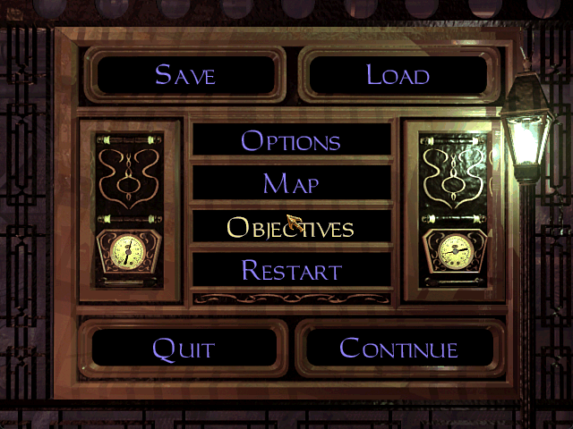
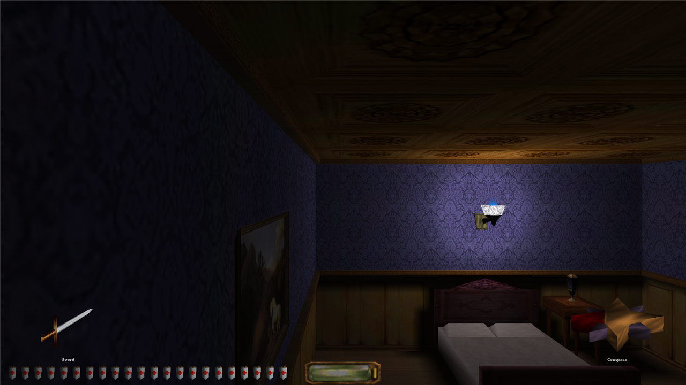
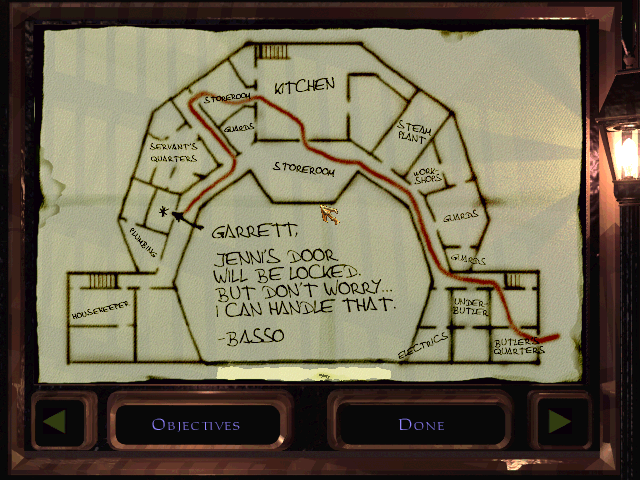

# Dark Engine restoration for Windows and Linux

This repository restores the historical Dark Engine sources as a portable,
working codebase. It builds a Thief 2 runner on Windows and Linux, plus a
preliminary Windows DromEd mission viewer. The engine core is shared across
platforms; operating-system, rendering, input, audio, movie, and filesystem
services are supplied by platform backends.

The repository does not include retail missions, movies, sounds, scripts, or
other game assets. A legally obtained installation of *Thief: The Dark
Project*, *Thief Gold*, or *Thief II: The Metal Age* is required.

## Platform status

| Capability | Windows x86 | Windows x64 | Linux x64 |
| --- | --- | --- | --- |
| Thief 2 | Playable | Playable; broader validation ongoing | Playable early port |
| DromEd | Viewer and playtest | Viewer and playtest; broader validation ongoing | Not implemented |
| Graphics | D3D11 | D3D11 | SDL2/OpenGL |
| Audio | DirectSound 3D or OpenAL | DirectSound 3D or OpenAL | OpenAL Soft |
| Movies | Media Foundation with legacy fallbacks | Media Foundation with legacy fallbacks | FFmpeg |
| Legacy `.osm` scripts | Native PE32 modules | IA-32 compatibility runtime | Partial IA-32 compatibility runtime |
| Squirrel scripts | Optional native Squirrel 3.2 provider | Optional native Squirrel 3.2 provider | Not implemented |
| Build system | Visual Studio 2022 | Visual Studio 2022 | CMake and Ninja |

The Windows Release targets build with the Visual Studio 2022 v143 toolset.
The x86 builds are the established target; native x64 builds compile and run
but remain under active runtime validation. The Linux CMake target builds a
native 64-bit ELF executable that can load retail missions and run gameplay.

Thief2 retains mission loading, the game UI, inventory, automap, and the
in-game command console. On Windows it also retains the normal startup and
movie flow. DromEd can load, inspect, and playtest legacy Thief 2 missions in
a resizable window, but should still be treated as a viewer rather than a
dependable editor. Editing and save integrity are not comprehensively
validated, and NewDark formats and features are not supported.

### Cross-platform architecture

Modern scene submission crosses the platform-neutral `h/render_backend.h`
boundary. Windows supplies D3D11 display and rendering providers under
`winsrc`; Linux supplies SDL2/OpenGL providers under `unixsrc`. Engine, UI,
movie, and `lgd3d` code use the shared renderer boundary rather than calling a
platform graphics API directly.

Core clocks, dynamic-library loading, memory queries, assertions, clipboard,
synchronization, and filesystem operations cross `platform_services.h` and
`platform_io.h`. The shared engine retains its historical data layouts while
the compatibility headers isolate Windows and LP64 ABI differences.

Native 64-bit builds include a compatibility runtime for legacy 32-bit `.osm`
script modules. It reads PE32 modules, interprets IA-32 code, and bridges the
supported script-manager and engine-service calls into the host process.
Windows builds made with `EnableSquirrel=true` also provide an in-process
Squirrel 3.2 script module for NewDark-style `sq_scripts/*.nut` sources; it
uses the normal Dark script manager and service interfaces rather than loading
the game-specific NewDark `squirrel.osm` binary. Both bridges are still being
expanded and validated against third-party scripts.

Audio follows the same provider model. Windows uses DirectSound 3D by default,
with native I3DL2 environmental reverb. An OpenAL provider supplies positional
audio, EFX reverb, and per-source occlusion when `OpenAL32.dll` is available;
set `sfx_backend openal` in `cam.cfg` to select it explicitly. The default
`auto` setting tries DirectSound first and uses OpenAL only if native audio
cannot initialize, so the standard executable has no OpenAL dependency.

Movie playback is exposed through the platform-neutral engine movie API. The
Windows Media Foundation, DirectShow, and legacy DirectDraw implementation is
isolated under `winsrc/movie`; Linux uses FFmpeg for video/audio decoding and
the existing SDL/OpenGL presentation surface.

Legacy PKWARE DCL-compressed resources are decoded in-process with Mark
Adler's small `blast` decoder under `3rdparty/blast`; newly written resources
use the engine's existing LZW codec. No external compression DLL is required.

### Thief2 runner features

The runner currently provides:

- use of an external retail Thief installation without copying its data;
- automatic TDP, Gold, or Thief II detection from the working directory;
- native display-resolution defaults when the user has not configured a
  resolution;
- borderless fullscreen and resizable windowed presentation;
- the standard Windows splash, startup, movie, and main-menu flow;
- direct mission startup and unattended frame-limited smoke tests; and
- a configurable command console, defaulting to `:` and `;` in every mode.

## Requirements

### Linux / WSL2

- A 64-bit Linux distribution with GCC, CMake, and Ninja
- SDL2, OpenGL, and libpng development headers
- OpenGL ES 3 development headers when building the optional ES renderer
- A retail Thief 2 installation
- OpenAL Soft at runtime for audio; the executable has no hard OpenAL link
- libsndfile at runtime for Ogg Vorbis sounds used by fan missions; it is
  loaded dynamically and is not a build dependency
- FFmpeg development libraries (`libavformat`, `libavcodec`, `libavutil`,
  `libswscale`, and `libswresample`) for movie playback. The build remains
  usable without them, but reports movies as unavailable.

On Ubuntu under WSL2, the minimal build packages are:

```sh
sudo apt update
sudo apt install build-essential cmake ninja-build libsdl2-dev libgl-dev \
  libpng-dev libsndfile1 libavformat-dev libavcodec-dev libavutil-dev \
  libswscale-dev libswresample-dev
```

Gameplay uses SDL's native relative-pointer mode and consumes motion deltas;
menus use absolute window coordinates. The provider prefers the compositor's
native Wayland path when it is advertised. WSLg may not confine its Windows
host cursor as reliably as a native Linux Wayland or X11 session.

WSLg audio uses its PulseAudio socket. If WSLg stops accepting audio clients,
close running WSL applications and run `wsl --shutdown` from PowerShell before
starting the game again.

### Windows

- 64-bit Windows 10 or Windows 11
- Visual Studio 2022 or Visual Studio 2022 Build Tools
- The **Desktop development with C++** workload, including:
  - MSVC v143 x86/x64 build tools
  - a Windows 10 or Windows 11 SDK
- A retail TDP, Thief Gold, or Thief II installation containing `cam.cfg` and
  the stock mission data
- FFmpeg's `ffmpeg.exe` on `PATH` when the installation has only the stock
  Indeo 5 AVIs and Windows has no compatible DirectShow decoder. It is not
  needed when H.264 MP4 siblings are already installed.

The Windows SDK supplies the DirectX declarations used by the Windows input,
audio, and rendering providers. Current Windows output uses a D3D11 swap chain
and Windows Media Foundation. No assembler is required by the active x86 or
x64 build.

## Build instructions

Squirrel 3.2 is an optional external Windows build dependency. Normal builds
do not require it. To enable Squirrel scripts, clone it into the ignored
`3rdparty/squirrel` directory:

```sh
git clone --branch v3.2 --depth 1 \
  https://github.com/albertodemichelis/squirrel.git 3rdparty/squirrel
```

Then add `/p:EnableSquirrel=true` to the MSBuild command. The checkout can live
elsewhere by also passing `/p:SquirrelSourceDir=C:\path\to\squirrel`. The
default is `EnableSquirrel=false`.

### Linux / WSL2

Keep the source and build trees in the Linux filesystem for good build
performance. From a WSL shell:

```sh
rsync -a --delete --exclude=.git --exclude=build --exclude=.codex-build \
  /mnt/c/path/to/darkengine/ ~/darkengine-src/
cmake -S ~/darkengine-src -B ~/darkengine-build -G Ninja \
  -DCMAKE_BUILD_TYPE=Release
cmake --build ~/darkengine-build -j "$(nproc)"
```

The Linux renderer uses an OpenGL 3.3 core context by default. To build the
same shader path against OpenGL ES 3 instead, install the GLES development
headers (`libgles-dev` on Ubuntu) and configure with
`-DDARK_OPENGL_ES=ON`.

The result is `~/darkengine-build/Thief2`, a native 64-bit ELF executable.

To exercise FFmpeg decoding, SDL audio, event handling, and OpenGL movie
presentation without entering the game, pass one absolute or working-directory
relative movie path:

```sh
~/darkengine-build/Thief2 movie_test=MOVIES/INTRO.AVI
```

### Windows with Visual Studio

1. Open `thief2.sln` in Visual Studio 2022.
2. Select the `Release` configuration and `x86` solution platform.
3. Build the solution with **Build > Build Solution**.
4. The resulting executable is
   `build\Release\Win32\Thief2\Thief2.exe`.

`Directory.Build.props` selects the Thief 2 target by default and applies the
packing and C-language compatibility settings required by the legacy code.
The game and editor intentionally use the same `src\dromed.vcxproj`; the
`BuildThief2` property selects which source set and executable name it emits.

### Windows command line

From an **x86 Native Tools Command Prompt for VS 2022**, run:

```bat
msbuild thief2.sln /m /t:Build /p:Configuration=Release /p:Platform=x86
```

The command should finish with
`build\Release\Win32\Thief2\Thief2.exe`.

To build DromEd from the same project, run:

```bat
msbuild thief2.sln /m /t:dromed /p:Configuration=Release /p:Platform=x86 /p:BuildThief2=false
```

The command should finish with
`build\Release\Win32\DromEd\DromEd.exe`. The editor switch also
works for a direct project build; `Directory.Build.props` supplies the solution
root needed by the legacy include and library paths:

```bat
msbuild src\dromed.vcxproj /m /t:Build /p:Configuration=Release /p:Platform=Win32 /p:BuildThief2=false
```

Use `Platform=x64` for a native 64-bit direct build. Final executables and
their object files are separated by architecture, configuration, and target:

```text
build\Release\Win32\Thief2\Thief2.exe
build\Release\Win32\DromEd\DromEd.exe
build\Release\x64\Thief2\Thief2.exe
build\Release\x64\DromEd\DromEd.exe
```

Static libraries remain shared between Thief2 and DromEd within a given
architecture. They must not vary with `BuildThief2`.

### Legacy OSM diagnostics

The portable OSM loader selects a fixed guest ABI when each module is loaded:
`gold` and `tdp` use the Dark 1 service layout, while `thief2` uses Dark 2.
Set `DARK_OSM32_TRACE=1` to log the selected ABI, service calls, and imports
that are not implemented by the guest runtime.

`osm32_probe` validates a PE32 script module without executing it. Use
`--imports` to list its imports or `--strict-imports` to fail when any import
is outside the runtime's supported manifest:

```powershell
.\build\Release\x64\osm32_probe.exe --strict-imports `
  'C:\Games\Thief Gold\SCRIPT.OSM'
```

The probe checks the PE image, required `_ScriptModuleInit@20` export,
relocations, and import surface. It does not replace an in-mission behavior
test because service calls and message traffic depend on retail mission data.

## Running

The executables read retail data in place; they do not copy it into this
repository.

### Linux

The native launcher accepts a retail installation from the working directory,
`DARK_GAME_PATH`, or `game_path=<directory>`. If an interactive launch starts
elsewhere, it asks for the installation folder before initializing the engine;
an invalid folder never enters the legacy assertion path. Dark then uses the
selected installation as its working directory because configuration and
resources resolve relative to it:

```sh
cd "/mnt/c/Games/Thief 2 - The Metal Age"
~/darkengine-build/Thief2 quickstart=MISS1.MIS
```

For a shortcut, script, or unattended launch from another directory:

```sh
~/darkengine-build/Thief2 game_path="/mnt/c/Games/Thief 2 - The Metal Age"
```

For an unattended smoke test, add `auto_stop=60`. Retail data on `/mnt/c`
works under WSL2 but loads more slowly than data in the Linux filesystem
because Dark performs many small, case-insensitive resource lookups.

A launch with no arguments opens the same engine-owned content menu used on
Windows. It uses the retail load-game artwork and controls; selecting content
restarts once with explicit `content=` and (for an FM) `fm=` assignments so
the chosen configuration is applied before resources are initialized.

### Windows

Set the working directory to the retail installation, then run the executable
by absolute path (or from a script/shortcut whose **Start in** directory is the
installation):

```powershell
Set-Location 'C:\Games\Thief Gold'
& 'C:\src\darkengine\build\Release\Win32\Thief2\Thief2.exe'
```

The runner identifies TDP, Gold, or Thief II from the installed stock mission
set. If the initial working directory is not a recognizable installation, it
prompts for one and uses the selected folder as the working directory for that
run. The picker starts at the last successfully selected game directory, stored
under `HKCU\Software\OpenDarkEngine\Launcher`; that value is only a picker hint
and is never used to choose or launch a game silently. Retail data is read in
place and is not copied.

A launch with no arguments opens the shared engine-owned content menu. It lists the
two original-campaign modes followed by every recognized immediate child of
the installation's configured `fm_path` directory (`FMs` by default). Display
names and descriptions come from
each FM's `fm.ini` when present. For example, select **Thief: The Black Parade
v1.0** and press **Play** to play the installed Black Parade campaign.

The available content modes are:

- **Original Missions (recommended)** suppresses both mod layers and uses the last existing
  entry in each base path, normally `RES` for resources and the installation
  root for missions. This is the most compatible mode for the original
  campaigns and is selected by default when no prior choice has been saved.
- **Original Missions - Modded** honors `uber_mod_path`, `mod_path`, and the full
  paths in the installation configuration. Installation-wide `cam_ext.cfg`
  defaults are read before `cam.cfg`, and `cam_mod.ini` supplies NewDark-style
  mod/FM settings. Use it for an installed enhancement pack, with the caveat
  that it can expose NewDark features this engine does not support yet.
- **Fan mission** selects one immediate child directory of the installation's
  `FMs` folder. Its files are inserted between `uber_mod_path` and `mod_path`,
  matching NewDark path precedence. An FM's `DARK.CFG`, `fm.cfg`, and
  `cam_ext.cfg` are loaded when Play is chosen. The resource and script search
  roots are refreshed in place before the main menu or mission content is
  entered, so the picker and game keep the same window and fullscreen state.

PNG replacement images are supported and take precedence over the original
TGA, GIF, PCX, CEL, and BMP resources. Image content is signature-sniffed
because NewDark FMs sometimes retain a `.gif` name for PCX, TIFF, or PSD data.
Indexed animations retain their own palettes and arbitrary GIF transparency
indices are normalized to Dark's index-zero convention. RGBA animation frames
are alpha-composited into the engine's 16-bit UI canvas.

Set `DARK_RESOURCE_TRACE=1` to include each resolved resource name, type, and
source path in `monolog`; this is useful for distinguishing a decoder problem
from an FM/mod/base path-precedence problem.

For shortcuts, scripts, and tests, bypass the chooser with explicit Dark-style
assignments (there are no GNU `--` prefixes):

```powershell
& $thief content=configured
& $thief content=vanilla
& $thief fm='TheDarkMansion'
```

The detected game, original-content mode, and each FM have separate save
directories under `%LOCALAPPDATA%\OpenDarkEngine\Profiles`. The content menu
remembers the last valid selection separately for each installation and has a
**Change Game Folder** command, so adding another game does not require editing
the registry or changing a shortcut.

### DromEd on Windows

DromEd uses the same working-directory detection as the game runner:

```bat
cd /d "C:\Games\Thief Gold"
"C:\src\darkengine\build\Release\Win32\DromEd\DromEd.exe"
```

The DromEd viewer uses the same D3D11 scene renderer and swap-chain presenter
as the game. Its legacy editor canvas remains 16-bit internally, while the D3D11
presenter converts it to the resizable 32-bit desktop window. When an editor
window resize finishes, DromEd recreates that canvas at the client area's
actual dimensions and scales the four viewports, console, status bar, and
brush controls independently in each axis. This fills widescreen and portrait
windows without imposing a 4:3 aspect ratio. `edit_screen_size` in `cam.cfg`
still selects the initial canvas size. Game preview mode stays in the same
window and recreates the D3D11 render context for the preview; returning to
edit mode restores the editor viewport and menu.

Use **Help > Keyboard Shortcuts** to open a resizable, human-readable input
reference. It includes every active editor binding (including the complete
built-in fallback set), non-conflicting shortcut annotations from the loaded
`menus.cfg`, and direct mouse/viewport gestures. Controls are grouped and
ordered by purpose, with modifier keys shown before the base key.

DromEd keeps its scrollable command console visible in the lower-right editor
pane. Press `:` or `;` to give its command line keyboard focus; **Escape**
releases focus without hiding the pane. It uses the same scrollback, command
history, completion, clipboard controls, and output path as the pop-up console
in gameplay and play preview.

The built-in historical editing command registry is present, but a complete
DromEd or NewDark editing environment also relies on command definitions and
companion-tool workflows supplied outside the engine executable. This
repository does not include or reproduce that complete external command
environment, so some familiar editor commands and tool-driven workflows are
unavailable rather than merely untested.

This build is therefore not yet a dependable mission-authoring environment.
Work from backups and do not rely on it as the only editor or copy of a
mission. DromEd can read the supported NewDark format prefixes and retains
newer or unknown chunks when saving, but raw preservation does not make a
modified chunk safely writable and this is not comprehensive NewDark
authoring support. In particular,
WREXT 0.30 and AIPATH 3.4 are currently read-only codecs: their original
chunks are retained instead of being rewritten by the legacy serializers.
RENDPARAMS 2.0 is prefix-decoded and retained, while CELL_MOTION 0.2 is fully
decoded (including its global water-projection threshold) and retained because
the legacy writer remains at 0.1. NewDark's 28-face brush records and 16,384
brush limit are accepted by the editor without changing the BRLIST 1.0 writer.

Serializer read ceilings are independent from writer versions. Unknown chunks,
newer read-only chunks, and unowned record suffixes are carried through an
editor save; this does not imply that their fields are editable.

Engine and file-format capacities are inventoried in `h/darklimit.h`. It keeps
the retail and NewDark values distinct from the runtime capacity: runtime code
uses the broadest supported representation, while WR, WREXT, AIPATH, automap,
and other codecs validate against their explicit on-disk limits. Subsystem
headers may retain historical names as aliases, but do not own the values.

Every mission and gamesys load appends a chunk-by-chunk report to
`mission_compatibility.log` in the selected game directory. Each entry is
classified as `decoded`, `prefix-decoded`, `raw-preserved`, or `unsupported`.
The report records the stored version and size so unsupported FM data can be
identified without raising the writer version or silently discarding it.

If `screen_size` or `game_screen_size` is already defined in `cam.cfg`, that
size is retained when the display driver supports it. Otherwise, the game
uses the closest supported mode to the native resolution of the display under
the mouse pointer at startup. The Video Options list merges the active
monitor's current Windows display modes with compatibility render sizes,
including 640x480, 800x600, and widescreen equivalents that fit on that
display. Resolutions are listed with the highest first; use the arrow buttons
or mouse wheel to reach lower entries such as 640x480 and 800x600.
Unsupported 24/32-bit NewDark settings are normalized to the engine's 16-bit
internal canvas. That canvas is converted to 32-bit color and presented by
D3D11; Windows is not switched into an obsolete 16-bit display mode. The
engine's gamma setting is applied by the D3D11 presentation shader using the
same power curve as the legacy palette correction.

The Video Options screen includes a **Display Mode** toggle. **Fullscreen**
uses a borderless window on the current display. **Windowed** uses a normal,
resizable window. Display-mode changes take effect immediately; resolution
changes are applied when **Done** is selected. In Windowed mode, the selected
resolution is the fixed internal render size, not a maximum window size.
Entering Windowed mode opens the client area at that size (clamped to the
monitor work area); resizing the window afterward only resizes the swap-chain
output and scales that fixed render canvas. Select **Fit** to make the engine's
3D scene and software overlay canvas follow the window's actual client-pixel
size. This keeps HUD, tutorial, and console text pixel-aligned instead of
resampling them from the selected fixed resolution. During an interactive
window resize, the last completed frame is scaled; the scene, depth buffer,
and software canvas are rebuilt once when the drag ends. The selected fixed
resolution is retained for when Fit is disabled. The settings can also be
changed in `cam.cfg` with `game_full_screen 1` or `game_full_screen 0` and
`game_screen_fit 1` or `game_screen_fit 0`.

On a multi-monitor system, the display containing the game window determines
both the resolution list and the target for borderless fullscreen. To change
displays, switch to Windowed, move the game window to the other display,
reopen Video Options, and then select a resolution or Fullscreen. The list is
queried again for that display; it is not assumed that every connected
display supports the same modes.

The retail game writes `skip_intro` after the intro has played. Add
`always_play_intro` to `cam.cfg` to show the intro on every launch. When the
retail movie directory contains both formats, the runner uses the H.264 MP4
through Windows Media Foundation instead of requiring the obsolete Indeo 5
codec used by the original AVI. If only the AVI exists and DirectShow cannot
decode it, the Windows runner uses `ffmpeg.exe` to prepare an H.264/AAC copy in
`%LOCALAPPDATA%\OpenDarkEngine\MovieCache`; it never changes the retail movie.
The cache key includes the source path, size, and timestamp. Set
`DARK_MOVIE_CACHE` to override the cache directory.

## Xbox controller support

Thief2 supports one active Xbox-style controller through a platform-neutral
gamepad layer, using runtime-loaded XInput on Windows and SDL GameController on
Linux. Controllers can be connected, disconnected, and reconnected while the
game is running. Keyboard and mouse remain active, and a modern controller is
not also polled through the legacy joystick path.

The default layout follows a NewDark-compatible Thief control scheme: left
stick moves and strafes, right stick looks, A jumps, B crouches, X/Y use or
frob, the triggers block and attack, the shoulders lean, and the D-pad cycles
inventory or weapons. View opens the automap and Menu opens the pause menu.
Stick clicks run and recenter the view. Menus accept D-pad navigation, A to
accept, and B or Menu to go back. These controls use semantic names such as
`pad_a`, `pad_rt`, and `pad_right_x` in `user.bnd`; existing `joy1` and
`joy_axis*` bindings remain valid as fallbacks.

Gamepad behavior can be adjusted in `cam.cfg`:

```text
gamepad_enable 1
gamepad_backend auto
gamepad_index 0
gamepad_left_deadzone 0.18
gamepad_right_deadzone 0.14
gamepad_left_response 1.0
gamepad_right_response 1.35
gamepad_trigger_press 0.15
gamepad_trigger_release 0.10
gamepad_look_sensitivity 1.0
gamepad_look_invert_y 0
gamepad_rumble 1
```

`gamepad_backend` accepts `auto`, `xinput`, `legacy`, or `off` on Windows and
`auto`, `sdl`, `legacy`, or `off` on Linux. One configured controller owns
gameplay input at a time; `gamepad_index` selects it, with automatic failover
to another connected controller if it disconnects. The
`gamepad_status` console command prints the selected backend and normalized
state. DromEd editor input remains unchanged; gamepad input is currently enabled
only in the Thief2 target.

On Linux, saves normally remain in the retail installation's `saves`
directory for compatibility with existing installs. If it cannot be created
or written, the game falls back to
`$XDG_DATA_HOME/OpenDarkEngine/Profiles/<game>/<content>/saves` (normally
`~/.local/share/OpenDarkEngine/...`). With no explicit override, loading checks
both locations. Set `DARK_SAVE_PATH` or pass `save_path=<directory>` to use one
specific directory for both saving and loading.

## Command console

The console appears as **Console** under **Options > Controls > Customize
Controls**. It defaults to both `:` and `;` in DromEd, DromEd play preview,
and Thief2 gameplay when those keys are free. Existing commands assigned to
either key are preserved. The console can be rebound like any other control,
and the selection is saved in `user.bnd`.

The console pauses gameplay while open. Press **Enter** to run a command and
keep the console open. Use the **mouse wheel**, drag anywhere on the scrollbar
track, or use **Page Up** and **Page Down** to move through its 4,096-line
scrollback; **Home** jumps to the oldest retained output and **End** returns to
the newest.
Hold **Ctrl** and turn the mouse wheel over the console to change its font
size. The permanently visible DromEd pane starts with the compact editor font,
while the pop-up gameplay console starts with a larger font; each profile
remembers its adjustment for the current run. Clicking the command-entry row
gives it keyboard focus.
Press **Ctrl+V** to paste into the command line. **Ctrl+C** copies the command
line when it is nonempty, or the visible output otherwise; **Ctrl+Shift+C**
copies all retained output. Press **Escape** to close the console and resume
play.

`help <keyword>` searches the names, descriptions, and argument types of the
commands available in the current mode. In gameplay, plain `help` prints a
short index of command groups; `help <group>` drills into one group, and
`help all` explicitly prints the complete active registry. Plain `help` in
DromEd opens its searchable command-reference window.

Available commands:

- `help [keyword]` - search the currently available command help
- `open_mission [number/shortname]` - start an installed mission
- `list_missions` - list installed missions and their short names
- `immunity [on/off]` - prevent player damage
- `flying [on/off]` - disable or restore player gravity
- `player_physics [on/off]` - toggle player collision and gravity for noclip
  free-flight while leaving world physics active
- `invisible [on/off]` - toggle the existing player-invisibility property
- `reticle [on/off]` - show or hide the center reticle
- `reticle_info` - describe the object and mesh under the reticle
- `list_scripts` - list loaded script classes
- `debug_scripts [on/off]` - log dispatched script messages to
  `script-debug.log`
- `console_copy [visible/all/command]` - copy console text to the clipboard
- `console_diagnostics [on/off]` - optionally include general `mprintf`
  diagnostic output in the console

In DromEd, bare `help` opens the searchable **Command Reference** window
instead of printing the complete editor command registry. Use `help <text>`
to print only matching commands in the console.

The earlier spellings `openmission`, `listmissions`, `playerphysics`,
`retinfo`, `listscripts`, and `debugscripts` remain compatibility aliases.

Long mission and script listings are appended to `thief-console.log`. Both log
files are ignored by Git.

## Screenshots

These captures were produced during local runtime verification with external
retail game data. The data shown in the captures is not included in the
repository.

### In-game menu



### Gameplay and inventory HUD



### Automap



## Known limitations and remaining work

- The x64 targets build and pass initial smoke tests, but are not yet as fully
  runtime-validated as Release/x86. The embedded compatibility runtime covers
  the IA-32 instructions, imports, and engine services exercised by tested
  legacy `.osm` modules; broader third-party script coverage remains ongoing.
- Modern rendering is still exposed through the historical `lgd3d` API as a
  compatibility facade over the renderer-neutral backend. The unusable
  Direct3D 2 implementation and its dormant build sources have been removed;
  callers still need migration away from the facade itself.
- The native 64-bit builds still need broader mission and save/load
  validation. The renderer also still uses a 16-bit internal canvas despite
  presenting through 32-bit D3D11 or OpenGL output, so full 32-bit scene
  rendering remains to be implemented.
- Native-resolution, high-DPI, window resizing, and ultrawide behavior need
  testing across more GPUs and display configurations.
- Gamma correction is implemented in the Windows D3D11 presentation path.
  Equivalent Linux/OpenGL behavior and broader visual comparison of shadow
  detail, lightmaps, and emissive-looking light-source textures remain to be
  completed.
- The first-run picker and startup path need clean-machine testing against the
  common CD, GOG, and Steam directory layouts.
- Most NewDark mission extensions are not supported. PNG replacement art and
  FM-local configuration are supported, but extended world/AI/property data
  still affects the runner's mod compatibility and DromEd's ability to open or
  preserve NewDark-specific missions.
- Stock Thief Gold mission/world and AI-path formats pass initial runner and
  DromEd smoke tests. TDP and broader Gold campaign/UI behavior still need
  validation; System Shock 2 is not a supported game target.
- DromEd is currently a viewer and playtest tool with partial editing support,
  not a general-purpose mission-authoring environment. The limitation is
  functional as well as a matter of validation: the repository does not
  provide the complete external DromEd/NewDark command environment or its
  companion-tool commands, and several owned mission formats still cannot be
  rewritten after editing. NewDark reading and raw preservation are partial;
  they do not imply safe NewDark authoring or save compatibility.
- Environmental audio now maps the original EAX room presets onto DirectSound
  I3DL2 or OpenAL EFX. DirectSound provides room reverb while the optional
  OpenAL provider also supplies per-source low-pass occlusion; both paths need
  broader in-mission acoustic comparison against the original game.
- Windows builds made with `EnableSquirrel=true` load NewDark-style loose
  `sq_scripts/*.nut` sources with the native Squirrel 3.2 provider. Core
  object, property, link, physics, Act/React, door, lock, damage, containment,
  quest, data, and light calls are bridged, but the complete NewDark service
  surface, overlay callbacks, and packaged Squirrel-source archives still need
  broader implementation and mission coverage.
- Broader NewDark mod compatibility remains to be implemented and tested,
  including replacement models and less common resource formats.
- There is no installer or redistributable package. The executable is run
  directly from the build output and uses separately installed retail data.
- Console scrollback retains the latest 4,096 output lines; command recall is
  a separate 256-command history. Long mission and script listings are also
  written to `thief-console.log`.
- `flying` disables gravity while preserving collision. Use `player_physics off`
  for noclip free-flight; its movement behavior still needs broader mission
  testing.
- `invisible` uses the engine's existing invisibility/render property. AI
  perception behavior has not been exhaustively verified for every mission.
- Keyboard-layout behavior for the default `:` and `;` console bindings needs
  broader testing on non-US layouts.
- The four Windows Release targets and native Linux Thief2 target compile and
  link with their configured toolchains. Raising warning levels and enabling
  additional static analysis remain future work.
- Automated runtime tests are limited because licensed retail data cannot be
  included in the repository or continuous-integration environment.

## Preservation and open access

This repository contains and modifies Dark Engine source code originating from
the unauthorized 2010 source leak. The historical source remains copyrighted
and was never released under an open-source license.

The repository exists for preservation, research, and modernization of the
engine. It does not include retail game assets. Contributors are expected to
use game data from their own lawfully acquired copies of the relevant Dark
Engine games when testing their code contributions.

Contributors freely license only their own original additions and modifications.
No rights are claimed in the underlying Dark Engine source or other third-party
material, and no license to that material is express or implied.
